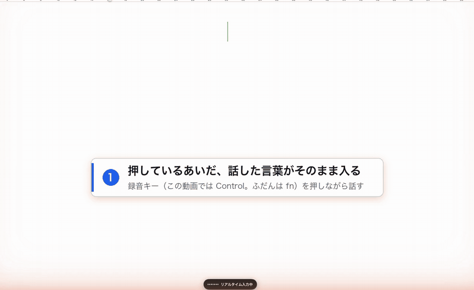

# koe!

[](../../releases/latest)


**koe** = 声（こえ）。macOS メニューバー常駐の日本語音声入力ユーティリティです。
`fn` を押している間だけ録音し、話している最中から前面アプリの入力欄へ文字を打ち込みます。
文字を選択した状態で話すと、話した指示（「丁寧語にして」など）で選択範囲を書き換えます。



## プライバシーとセキュリティ

- 開発者のサーバーにデータが送信されることはありません
- 音声認識は Mac 内の SpeechAnalyzer で行い、録音データも文字起こしも Mac の外に出ません（初回のみ、日本語の認識モデルを Apple から取得することがあります）
- 選択範囲の修正は Apple Intelligence のオンデバイスモデルで行い、テキストは Mac の外に出ません
- 辞書・履歴・設定はすべて Mac 内（UserDefaults）に保存されます
- 動作ログは `~/Library/Logs/Koe/koe.log` に、本人だけが読める権限で保存されます（起動のたびに作り直します）
- サードパーティライブラリを含みません（Apple 純正フレームワークのみ）
- 利用状況の収集・送信は一切行いません

## 動作環境

- macOS 26 以上
- 選択範囲の修正だけ、Apple Intelligence に対応した Mac で **システム設定 > Apple Intelligence と Siri** をオンにする必要があります。オフでも音声入力は使えます

## インストール（DMG から）

開発環境は不要です。

### 1. ダウンロード

[GitHub Releases](../../releases/latest) から最新の `Koe-*.dmg` をダウンロードしてください。

### 2. アプリを Applications にコピー

DMG を開いて `Koe.app` を `Applications` フォルダにドラッグ＆ドロップします。

### 3. 初回起動（Gatekeeper の許可）

このアプリはアドホック署名のため、初回起動時に macOS の Gatekeeper にブロックされます。

1. `/Applications/Koe.app` をダブルクリック → ブロックされるので **「完了」** を押す
2. **システム設定 > プライバシーとセキュリティ** を開く
3. 画面下部に表示される **「このまま開く」** をクリック
4. 確認ダイアログで **「開く」** をクリック（以降はダブルクリックで起動可能）

### 4. 権限を許可

初回起動時にダイアログが表示されるので、以下をすべて許可してください。設定画面の「権限」でも状態を確認できます。

- マイク
- 音声認識
- アクセシビリティ（システム設定 > プライバシーとセキュリティ > アクセシビリティ）
- 入力監視（システム設定 > プライバシーとセキュリティ > 入力監視）

## 使い方

### 音声入力

| 操作 | 動作 |
|------|------|
| `fn` を押しながら話す → 離す | 話している間に文字が入力され、離すと確定（プッシュトゥトーク） |
| `fn` を素早く 2 回押す | ハンズフリー録音。キーを離したまま話し、もう一度 `fn` で確定。30 秒話さなければ自動で確定 |
| 録音中に `esc` | 録音を取り消し、その録音で入力した文字をすべて消す |
| `⌃⌘V` | 直前の入力をもう一度貼り付け |

- 録音キーは設定で `fn`・右 Option・Control から選べます
- 録音キーが `fn`・右 Option・Control のどれでも、長押し中から文字が入力されます
- `fn` を押した瞬間から録音するため、話し始めの言葉が欠けません。画面下の表示は 0.25 秒以上押したときだけ出ます
- `fn` を短く 1 回押しただけ（入力ソースの切り替えなど）の場合は何も入力しません
- 押している間に別のキーを押した場合（`fn`+矢印キーなどのショートカット）は録音を取り消します
- 認識が固まるにつれて入力済みの文字が書き直されます。句読点も付きます
- 日本語入力がオンでも文字が変換されないよう、打ち込む間だけ英字入力に切り替え、終わると元の入力ソースに戻します
- 入力中に別のアプリや入力欄へ移ったり、クリックやキー入力で入力位置を動かしたりすると、打った文字はその場に残し、続きを移った先に打ち込みます。ハンズフリーのまま複数の場所へ続けて入力できます。移る前に打った文字は、後で認識結果が変わっても直しません
- パスワード入力欄に移ると打ち込みを止めます。`⌃⌘V` で全文を貼り付けられます

### 辞書

固有名詞や同音異義語が別の語で入力される場合は、設定の「辞書」に登録します。

| 欄 | 内容 | 例 |
|------|------|------|
| 正しい表記（必須） | 入力したい語。音声認識に聞き取りの手がかりとして渡します | `Slack` |
| 誤認識（任意） | 実際に出てしまった語。カンマか読点で区切って複数書けます | `スラック, スラッグ` |

誤認識に書いた語が出ると、入力する前に正しい表記へ置き換えます。手がかりだけでは直らない語も、誤認識を書いておけば確実に直ります。変更は次の録音から反映されます。

### 履歴

メニューバーのアイコン →「履歴」に直近 10 件の入力が新しい順に並びます。選ぶとクリップボードにコピーし、画面下に「コピーしました」と表示します。「履歴を消去」で空にできます。

### 効果音

確定したときと取り消したときに小さな音を鳴らします（録音の開始は画面下の表示で分かるため、音は鳴らしません）。設定の「一般」でオフにできます。

### 選択テキストの修正

既に入力済みのテキストを音声指示で書き換えられます。

1. 修正したいテキストを選択（`Cmd+A` やドラッグ等）
2. `fn` を押しながら（またはダブルタップでハンズフリーにして）話す。画面下の表示が紫になり「選択範囲を修正」と表示されます
3. 「丁寧語にして」「箇条書きにして」「時間を16時に変えて」「英語にして」等と話す
4. `fn` を離すと Apple Intelligence が書き換え、選択テキストを置き換えます

Apple Intelligence が使えない場合は理由を表示し、何も書き換えません。使えるかどうかは設定の「入力」で確認できます。

## トラブルシュート

- `アクセシビリティを許可してください` が消えない
  - 許可対象が `/Applications/Koe.app` か確認
  - アプリ再起動を実施

- `fn` で起動しない
  - `入力監視` が ON か確認
  - システム設定 > キーボード > `🌐キーを押して` を `何もしない` に変更

- 設定をやり直したい
  - **ターミナル.app**（Launchpad > その他 > ターミナル）を開き、以下を 1 行ずつ貼り付けて実行してください

```bash
tccutil reset Accessibility com.koe.app
tccutil reset ListenEvent com.koe.app
tccutil reset PostEvent com.koe.app
```

> 実行後、アプリを再起動すると権限ダイアログが再表示されます。

---

## 開発者向け

### 設計ドキュメント

- [ARCHITECTURE.md](ARCHITECTURE.md)

### 前提環境

- macOS 26 以上
- Xcode Command Line Tools（macOS 26 SDK）
- Swift 6.2+（`swift build` が動くこと）

### ソースからビルド

```bash
git clone https://github.com/hanafusay/koe.git
cd koe
./build.sh
open /Applications/Koe.app
```

`build.sh` は release ビルド → .app バンドル作成 → コード署名 → `/Applications` にインストールまで一括で行います。
DMG からインストール済みの場合でも、バンドル ID が同じため `/Applications/Koe.app` が開発ビルドで上書きされます。TCC 権限（アクセシビリティ・入力監視等）はそのまま引き継がれるので再設定は不要です。元に戻すには DMG から再インストールしてください。

権限付与後にアプリを再起動:

```bash
pkill -x Koe; open /Applications/Koe.app
```

### 動作確認

`/Applications` に入れずに確かめられる仕組みがあります。

```bash
# 録音キーの状態遷移・リアルタイム入力の打ち直し・辞書の置き換えを検査する
bash scripts/check-trigger-state-machine.sh

# 音声ファイルを本番と同じ認識経路に流し、途中結果と打ち込む操作を表示する（キー入力は送らない）
say -v Kyoko -o /tmp/d.aiff "スラックで仕様を確認します"
source scripts/lib.sh && build_release   # Command Line Tools だけの環境では macOS 26 SDK を選んでビルド
.build/release/Koe --transcribe-file /tmp/d.aiff --dictionary Slack=スラック,仕様=使用

# 画面下の表示・設定画面・メニューを PNG に書き出す
.build/release/Koe --render-snapshots /tmp/koe-snapshots
```

`--dictionary` は保存済みの辞書の代わりに使う辞書で、`正しい表記=誤認識` をカンマで区切って並べます。
`--render-snapshots` の設定画面とメニューは、権限を持たない開発用バイナリで描くため権限が「未許可」と表示されます。

### DMG の作成

```bash
./create-dmg.sh
# dist/Koe-<version>.dmg が生成される
```

### リリースの作り方

タグを push すると GitHub Actions が自動で DMG を作成し、GitHub Releases に公開します。

```bash
git tag v1.x.0
git push origin v1.x.0
```

## ライセンス

[MIT License](LICENSE)
